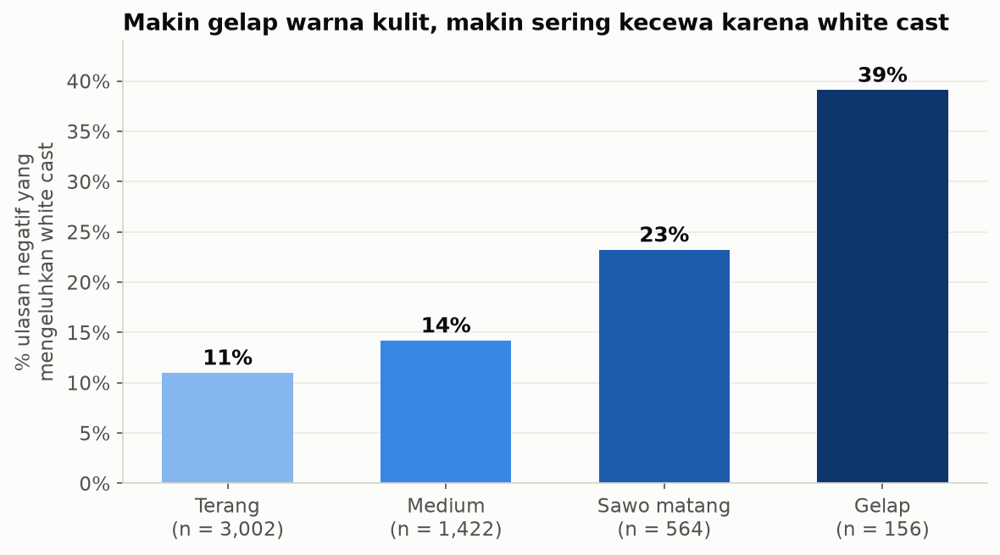

# Keluhan Pembeli Sunscreen dari 1,09 Juta Ulasan Skincare Sephora

Proyek ini menganalisis ulasan produk skincare di Sephora untuk menjawab dua pertanyaan: kategori skincare mana yang paling sering mengecewakan pembeli, dan apa yang mereka keluhkan. Hasilnya dipakai untuk menyusun masukan produk bagi brand sunscreen lokal, dengan Wardah dan Emina sebagai contoh.

Hasil akhir tersedia dalam tiga bentuk: workbook Excel dengan dashboard berfilter, tiga notebook Python, dan dashboard HTML yang bisa dibuka tanpa internet.

## Hasil utama

Sunscreen adalah kategori besar dengan proporsi ulasan negatif tertinggi. Dari 41.100 ulasan sunscreen, 13,8% memberi rating 1–2 bintang, sedangkan rata-rata seluruh skincare 10,4%. Self Tanners (16,0%) dan High Tech Tools (15,0%) lebih tinggi, tetapi jumlah ulasannya hanya 12 ribu dan 6 ribu.

Hampir semua keluhan pembeli sunscreen menyangkut pengalaman memakai produk. Keluhan bahwa produk tidak melindungi dari matahari hanya muncul di 2,8% ulasan negatif. Tabel berikut dihitung dari 5.675 ulasan negatif dan 31.934 ulasan positif sunscreen:

| Keluhan | % ulasan negatif | % ulasan positif | Lift |
|---|---|---|---|
| Berminyak, lengket, atau berat | 32,4% | 15,1% | 2,1× |
| Jerawat atau breakout | 15,1% | 4,5% | 3,4× |
| Pilling (menggumpal) | 14,0% | 1,6% | 8,6× |
| White cast | 13,5% | 5,8% | 2,3× |
| Tidak melindungi dari matahari | 2,8% | 0,9% | 3,0× |

Lift adalah persentase di ulasan negatif dibagi persentase di ulasan positif. Pilling jarang disebut oleh pembeli yang puas, sehingga tema ini paling kuat membedakan ulasan negatif. Bau atau wangi disebut di 15% ulasan negatif tetapi lebih sering di ulasan positif (lift 0,7×), jadi aroma bukan penyebab utama kekecewaan.

Keluhan white cast meningkat seiring warna kulit pengulas:

| Warna kulit | Ulasan negatif | Menyebut white cast |
|---|---|---|
| Terang | 3.002 | 11% |
| Medium | 1.422 | 14% |
| Sawo matang | 564 | 23% |
| Gelap | 156 | 39% |

Kelompok gelap hanya punya 156 ulasan negatif, jadi angkanya kurang stabil. Pola kenaikannya tetap konsisten di keempat kelompok.



Temuan lain:

- Harga hampir tidak berhubungan dengan rating produk (korelasi Spearman 0,13). Persentase pengulas yang merekomendasikan produk adalah 81,6% untuk produk di bawah $25, 84,0% untuk $25–50, 85,9% untuk $50–100, dan 83,9% untuk produk di atas $100.
- Pada kulit berminyak, 41% ulasan negatif sunscreen mengeluhkan tekstur berminyak dan 19% mengeluhkan jerawat. Pada kulit kering, keluhan iritasi lebih tinggi (14%, dibanding 9% pada kulit berminyak).
- Di antara sunscreen dengan sedikitnya 1.000 ulasan, proporsi ulasan negatif berkisar dari 1,3% (Shiseido Urban Environment Fresh-Moisture) sampai 33,3% (Drunk Elephant Umbra Sheer).

## Rekomendasi

Rekomendasi diurutkan menurut seberapa sering masalahnya muncul di data.

1. Tekstur ringan dengan hasil akhir matte. Keluhan berminyak menempati urutan pertama di semua jenis kulit.
2. Formula yang tidak meninggalkan white cast pada kulit sawo matang, diuji pada warna kulit konsumen Indonesia.
3. Tidak menggumpal saat dilapisi skincare atau makeup.
4. Klaim non-comedogenic yang didukung pengujian, karena jerawat adalah keluhan kedua terbanyak.
5. Varian yang lebih lembut untuk kulit kering atau sensitif.

Rekomendasi ini berasal dari data pasar Amerika Serikat. Sebelum dipakai untuk keputusan produk, pola yang sama perlu dicek pada ulasan e-commerce Indonesia.

## Cara melihat hasil

| File | Isi |
|---|---|
| `Portofolio_Ulasan_Skincare_Sephora.xlsx` | Dashboard Excel dengan filter jenis kulit, warna kulit, dan tahun. Mulai dari sheet Dashboard, lalu telusuri setiap angka ke sheet Analisis. |
| `dashboard/index.html` | Versi web dari dashboard. Buka langsung di browser, tidak perlu internet. |
| `notebooks/01_data_understanding_cleaning.ipynb` | Pemuatan data, pengecekan kualitas, dan pembersihan. |
| `notebooks/02_eda.ipynb` | Analisis per harga, kategori, jenis kulit, tahun, dan brand. |
| `notebooks/03_sunscreen_complaints.ipynb` | Deteksi tema keluhan sunscreen dan rekomendasi. |
| `reports/figures/` | Sembilan grafik PNG dari notebook. |

Di workbook Excel, sel kuning di sheet Dashboard adalah filter. Semua KPI, grafik, dan heatmap dihitung ulang dengan rumus SUMIFS setiap kali filter diganti.

## Data

Sumber: [Sephora Products and Skincare Reviews](https://www.kaggle.com/datasets/nadyinky/sephora-products-and-skincare-reviews) di Kaggle, diunggah oleh nadyinky. Dataset terdiri dari satu file produk (8.494 produk) dan lima file ulasan (1.094.411 ulasan).

Pengecekan awal menunjukkan bahwa semua ulasan berasal dari produk kategori Skincare, walaupun file produk juga berisi Makeup, Hair, Fragrance, dan kategori lain. Karena itu, analisis dibatasi pada 2.420 produk skincare dari 143 brand.

Langkah pembersihan:

- Lima file ulasan digabung. Tidak ditemukan baris duplikat, dan setiap ulasan punya pasangan di file produk.
- 1.444 ulasan tanpa teks dibuang (0,1%). Data yang tersisa berisi 1.092.967 ulasan dari 502.564 pengulas, periode Agustus 2008 sampai Maret 2023.
- Kolom harga diskon, harga nilai, dan deskripsi varian dibuang karena lebih dari 85% isinya kosong.
- Jenis kulit dan warna kulit yang kosong diberi label "unknown" dan tetap dipakai. Membuangnya akan menghilangkan sekitar 10% ulasan.
- Harga dikelompokkan menjadi empat: di bawah $25, $25–50, $50–100, dan di atas $100.

Data 2023 hanya mencakup Januari sampai Maret, sehingga jumlah ulasan tahun itu tidak bisa dibandingkan dengan tahun penuh.

## Metode

### Metrik

- Ulasan negatif: ulasan dengan rating 1 atau 2 bintang, dibagi seluruh ulasan pada kelompok yang sama.
- Merekomendasikan: jawaban "ya" pada pertanyaan rekomendasi, dibagi pengulas yang menjawab. Pengulas yang tidak menjawab tidak dihitung. Pertanyaan ini baru muncul di data pada 2017 (sekitar separuh ulasan 2017 dan semua ulasan sejak 2018), jadi metrik ini hanya mewakili ulasan 2017 sampai 2023.
- Setiap rasio dihitung dari total pembilang dibagi total penyebut, bukan dari rata-rata persentase antarkelompok.
- Kategori dengan kurang dari 5.000 ulasan tidak dibandingkan. Yang terdampak hanya kategori "Shop by Concern" dengan 15 ulasan.

### Deteksi tema keluhan

Setiap tema keluhan punya daftar kata kunci. Tema berminyak, misalnya, mencakup "greasy", "oily", "sticky", dan "heavy". Sebuah ulasan dihitung mengeluhkan suatu tema jika kata kuncinya muncul tanpa didahului kata negasi seperti "no", "not", "doesn't", atau "without" dalam tiga sampai empat kata sebelumnya.

Penanganan negasi diperlukan karena hitungan kata biasa memberi hasil yang terbalik. Frasa "white cast" muncul di 19% ulasan positif dan hanya 14% ulasan negatif, sebab pembeli yang puas sering menulis "no white cast".

Hasil deteksi diperiksa dengan membaca sampel acak ulasan di setiap tema. Pemeriksaan itu menemukan salah tangkap pada frasa "oily skin", "dry skin", dan "acne-prone". Ketiganya menyebut jenis kulit pengulas, jadi pola kata kuncinya diubah agar frasa tersebut tidak lagi terhitung sebagai keluhan.

### Kenapa data Excel diringkas

Data ulasan berisi lebih dari 1 juta baris, melebihi batas Excel sebanyak 1.048.576 baris. Python meringkas ulasan menjadi 8.137 baris (kategori × kelompok harga × jenis kulit × warna kulit × tahun) dan 432 baris untuk tema keluhan sunscreen. Semua metrik berupa jumlah atau rasio jumlah, jadi hasilnya tetap sama dengan perhitungan di level ulasan. Sheet Kualitas di workbook mencocokkan total hasil ringkasan dengan angka dari Python.

## Keterbatasan

- Data berasal dari Sephora di Amerika Serikat. Konsumen, iklim, dan produk yang dijual berbeda dari pasar Indonesia.
- Deteksi kata kunci masih bisa salah tangkap. Kalimat "I hate sunscreens that leave a white cast, but this one is great" tetap terhitung sebagai keluhan white cast. Membandingkan ulasan negatif dengan ulasan positif mengurangi dampaknya, karena kesalahan yang sama terjadi di kedua kelompok.
- Orang yang menulis ulasan belum tentu mewakili semua pembeli. Pembeli yang sangat puas atau sangat kecewa cenderung lebih sering menulis ulasan.
- Semua hubungan dalam analisis ini adalah korelasi. Data menunjukkan bahwa ulasan negatif lebih sering menyebut white cast, tetapi tidak membuktikan bahwa white cast adalah penyebab rating rendah.

## Struktur folder

```
sephora-skincare-analysis/
├── Portofolio_Ulasan_Skincare_Sephora.xlsx
├── dashboard/
│   ├── index.html            dashboard web (hasil build)
│   └── template.html         tampilan dan logika dashboard web
├── data/
│   ├── raw/                  file CSV dari Kaggle (tidak disertakan)
│   └── processed/            hasil pembersihan (Parquet)
├── notebooks/                analisis langkah 1–3
├── reports/figures/          grafik PNG
├── src/
│   ├── build_dashboard.py    membangun dashboard/index.html
│   ├── build_excel.py        membangun workbook Excel
│   └── recalc_excel.ps1      menghitung ulang rumus lewat Excel dan mencari sel error
└── requirements.txt
```

## Menjalankan ulang

Proyek ini memakai Python 3.12. Folder `data/raw/` dan `data/processed/` tidak disertakan karena ukurannya besar.

1. Unduh dataset dari Kaggle, lalu letakkan `product_info.csv` dan kelima file `reviews_*.csv` di `data/raw/`.
2. Buat environment dan pasang library:

   ```bash
   uv venv --python 3.12 .venv
   ```

   ```bash
   uv pip install --python .venv/Scripts/python.exe -r requirements.txt
   ```

3. Jalankan ketiga notebook secara berurutan. Notebook 01 membuat file di `data/processed/`.
4. Bangun dashboard web dan workbook Excel:

   ```bash
   .venv/Scripts/python.exe src/build_dashboard.py
   ```

   ```bash
   .venv/Scripts/python.exe src/build_excel.py
   ```

5. Hitung ulang rumus workbook. File yang ditulis Python belum berisi hasil rumus. Membuka workbook di Excel sudah cukup, atau jalankan perintah berikut di Windows yang memiliki Excel:

   ```bash
   powershell -ExecutionPolicy Bypass -File src/recalc_excel.ps1
   ```

## Tools

Python (pandas, NumPy, Matplotlib, openpyxl), Jupyter, Microsoft Excel, dan HTML/JavaScript untuk dashboard web.

Dibuat oleh Nakata sebagai portofolio data analyst.
